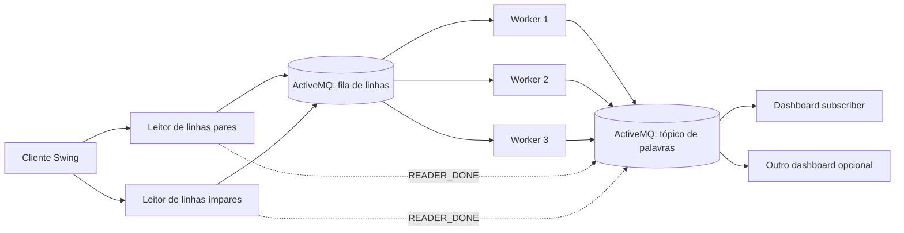

# Roteiro para explicar o código

## Como o código atende ao enunciado

| Etapa do projeto | Implementação |
|---|---|
| Cliente pede palavras e inicia o trabalho | `MomClient`, `ClientFrameMOM` e `WorkflowMOM` |
| Leitor de linhas pares | `LineReaderMOM.produce(..., parity = 0, ...)` |
| Leitor de linhas ímpares | `LineReaderMOM.produce(..., parity = 1, ...)` |
| Produtores enviam linhas ao broker | `MessageProducer.send()` na fila `mom.linhas.<UUID>` |
| Consumidores dividem o trabalho | `WordWorkerMOM.consume()` e `MessageConsumer.receive()` |
| Contagem por palavra-chave | `WordCounterMOM.count()` |
| Workers publicam quantidades no tópico | `MessageProducer.send()` de `RESULT` no tópico `mom.palavras` |
| Subscriber atualiza dashboard | `TopicSubscriberMOM`, `ResultModelMOM` e `DashboardFrameMOM` |

## Fluxo da execução



`WorkflowMOM.execute()` primeiro cria a assinatura do tópico, depois os workers e as duas tarefas de leitura. A ordem evita perder eventos em um tópico não durável. As threads usam conexões e sessões JMS próprias; as sessões não são compartilhadas entre as tarefas.

O arquivo é percorrido com `Files.newBufferedReader`. O contador de linha começa em 1 e a condição `number % 2 == parity` escolhe quais linhas enviar. Ambos os leitores percorrem todo o arquivo, porém publicam conjuntos complementares. Nenhuma etapa usa `readAllLines` ou mantém o texto completo na memória.

## Fila versus tópico

Na fila, workers competem pelas mensagens. Uma linha confirmada é retirada por um consumidor; não se deve enviar a mesma linha para todos os workers. Aumentar o número de workers permite processar mais linhas em paralelo, sujeito ao custo de CPU, leitura e comunicação.

No tópico, cada assinatura ativa recebe sua própria cópia dos resultados. Por isso dois dashboards chegam aos mesmos totais, em vez de dividir as contagens entre si. Os testes abrem dois subscribers e verificam esse comportamento com workers em três JVMs separadas.

## Por que a transação está no worker

O consumo da fila e a publicação do resultado acontecem na mesma sessão JMS transacional:

```java
Message input = consumer.receive(500);
// contar palavras e criar RESULT
publisher.send(output);
session.commit();
```

Se houver falha antes da confirmação, o rollback disponibiliza a linha novamente. Confirmar o consumo primeiro e publicar depois permitiria perder uma contagem no intervalo entre essas duas operações. Essa propriedade vale enquanto o broker mantém seu estado; a aplicação não possui persistência nem recuperação após reiniciar o broker.

## Como a contagem funciona

`ProtocolMOM.keywords()` separa as palavras por vírgula, ponto e vírgula ou quebra de linha, aplica normalização Unicode NFC e minúsculas com `Locale.ROOT`, remove duplicatas e valida as entradas.

`WordCounterMOM.count()` percorre os tokens da linha e consulta um mapa de posições das palavras pesquisadas. Isso evita comparar cada palavra-chave com cada trecho do texto. A regra de tokens inclui letras Unicode, marcas de acento, números e `_`. `java` e `JAVA` são equivalentes; `JavaScript` não conta como `java`. Acentos são preservados.

## Como o dashboard sabe que terminou

Os dois leitores podem terminar antes que a fila seja esvaziada. Cada leitor publica um `READER_DONE` com sua quantidade de linhas. `ResultModelMOM` espera esses dois eventos e compara a soma com o número de resultados distintos recebidos. Assim, uma fila momentaneamente vazia ou um leitor que terminou não encerra o trabalho prematuramente.

O modelo usa métodos sincronizados e snapshots imutáveis. Guarda os totais, os dados dos workers e bitmaps para identificar linhas já recebidas. Não guarda os textos das linhas. A interface consulta snapshots a cada 150 ms, na EDT; callbacks JMS não alteram componentes Swing.

## O que mostrar na apresentação

1. Abra o cliente e selecione o arquivo de exemplo. Pesquise `java, paralelo, distribuída`.
2. Inicie e mostre os totais `4, 3, 4`, respectivamente, e as cinco linhas processadas.
3. Mostre `LineReaderMOM`: duas execuções, seleção por paridade e envio à fila.
4. Mostre `WordWorkerMOM`: recebimento, contagem, publicação e `commit()` na mesma sessão.
5. Mostre `TopicSubscriberMOM` e a condição de conclusão em `ResultModelMOM`.
6. Para tornar as atualizações visíveis, use um arquivo maior. O exemplo pequeno pode concluir antes do primeiro refresh da interface.
7. Demonstre um broker separado e workers externos conforme o README. Opcionalmente abra um segundo dashboard antes de iniciar.
8. Execute `build.ps1` ou `mvn clean package` e mostre o resumo das verificações.

## Relação com os projetos anteriores

Mantêm-se Java 25, Swing, pacotes em `br.com.victorsfec`, separação de cliente e componentes compartilhados, nomes específicos por tecnologia, `pom.xml`, `build.ps1`, testes executáveis e documentação em `docs/`. O domínio passa de Fanorona para contagem de palavras, por isso o pacote é `br.com.victorsfec.mom`.

Na versão de sockets, a aplicação implementa conexões e um protocolo de comandos. Na versão RMI, utiliza objetos remotos. Neste projeto, os componentes trocam mensagens assíncronas por destinos administrados pelo broker, usando produtor/consumidor e publisher/subscriber. O código pode iniciar tudo em uma JVM para facilitar a demonstração, mas continua usando JMS/TCP; os executáveis separados demonstram o desacoplamento entre os processos.

## Referências técnicas

- [ActiveMQ Classic: configuração inicial](https://activemq.apache.org/components/classic/documentation/initial-configuration)
- [ActiveMQ Classic: produtores e consumidores JMS](https://activemq.apache.org/components/classic/documentation/hello-world)

As orientações acadêmicas de apresentação e envio do enunciado devem ser cumpridas pelo aluno. Os executáveis e fontes são fornecidos nesta entrega para revisão e apresentação.
