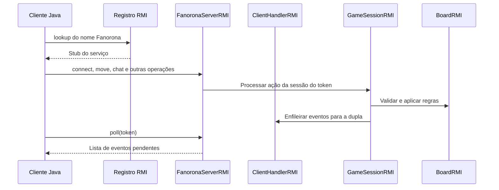
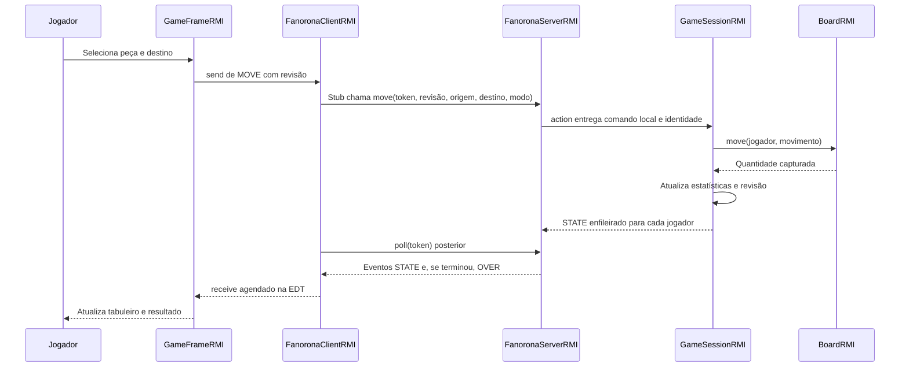
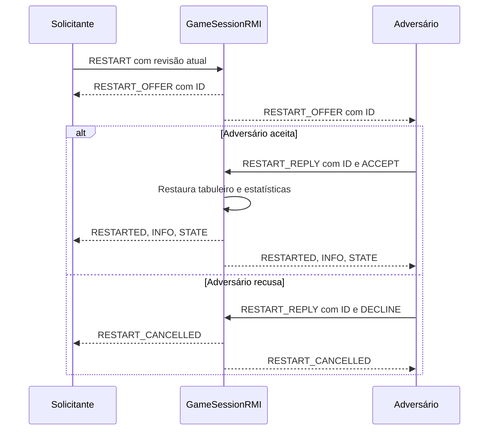

# Fanorona com Java RMI: documentação do código

Guia de estudo e apresentação do projeto de Programação Paralela e Distribuída, IFCE, semestre 2026.2.

Documentação baseada no código local em 13 de outubro de 2026. Segue a organização e o estilo do guia de sockets, com trechos reais, leitura passo a passo e explicações reunidas por assunto. As regras e a interface reaproveitadas são explicadas integralmente para que este documento possa ser usado sozinho.

## 1. Visão geral

Dois clientes Java obtêm uma referência remota ao servidor e chamam operações do serviço Fanorona. O servidor mantém o tabuleiro oficial, valida ações e coloca eventos nas caixas dos jogadores. Cada cliente consulta sua caixa periodicamente e atualiza o Swing na EDT. Duplas distintas possuem sessões independentes.

| Pacote | Responsabilidade | Classes |
|---|---|---|
| server | Publicar serviço, identificar jogadores e controlar partidas | FanoronaServerRMI, ServerFrameRMI, ClientHandlerRMI, GameSessionRMI |
| client | Chamar o serviço e apresentar snapshots | FanoronaClientRMI, GameFrameRMI, ResultsDialogRMI |
| game | Representar o tabuleiro e validar regras | BoardRMI, PieceRMI |
| shared | Definir operações e formato dos eventos | FanoronaServiceRMI, ProtocolRMI |

### O que significa usar RMI neste projeto

RMI é a infraestrutura Java de invocação de métodos em outro processo. O cliente trabalha com a interface FanoronaServiceRMI e com um stub, uma referência que encaminha chamadas para o objeto exportado no servidor. O método executa no servidor; a chamada pode esperar rede e falhar. Por isso, as operações ficam fora da thread gráfica.

O registro RMI relaciona o nome Fanorona à referência do serviço. Não contém o tabuleiro e não decide jogadas. O servidor cria o registro e exporta a implementação na mesma porta. Os clientes consultam o registro, obtêm o stub e passam a chamar o serviço. O projeto não precisa de um processo rmiregistry separado.

| Funcionalidade | Comportamento |
|---|---|
| Iniciar/parar servidor | Criar/despublicar serviço e registro pelo painel |
| Conectar e parear | Nome validado, token próprio e uma sessão para cada dupla |
| Jogar e capturar | Servidor valida turno, revisão e regras de aproximação/afastamento |
| Interface | Sombra das peças elegíveis, seleção azul e destinos verdes |
| Sequência | Mesma peça, sem revisitar pontos nem repetir direção anterior |
| Chat e resultado | Chat da dupla, desistência, empate e estatísticas |
| Demonstração /final | Preparar captura decisiva C3 para D3 |
| Reiniciar por acordo | Solicitante e adversário preservados; novo tabuleiro após aceite |
| Detectar saída | disconnect normal ou expiração após ausência de chamadas |



RMI usa TCP internamente, mas o código da aplicação não abre Socket/ServerSocket nem lê linhas da rede. Strings com separadores permanecem como formato local de comandos e eventos para reaproveitar a interface e a sessão.

## 2. Ordem de execução

### 2.1 Do início até o primeiro turno

1. FanoronaServerRMI.main valida a porta e escolhe painel ou console.
2. No painel, Iniciar Servidor executa startServer e um SwingWorker.
3. O construtor cria Registry, exporta o servidor e publica o nome Fanorona.
4. A manutenção começa a verificar sessões inativas a cada segundo.
5. FanoronaServerRMI.run aguarda o encerramento; as chamadas são despachadas pela infraestrutura RMI.
6. FanoronaClientRMI.main recebe nome, host e porta.
7. connect abre a tela e agenda lookup fora da EDT.
8. O cliente chama service.connect(name), recebendo um token UUID.
9. O servidor coloca o handler na espera e forma uma sessão quando há dois.
10. GameSessionRMI.start enfileira WELCOME e STATE.
11. O cliente inicia poll com atraso fixo de 200 ms e encaminha eventos à EDT.
12. A tela recebe identidade e snapshot; P1 começa.

A ordem efetiva de entrada na fila, durante connect válido no servidor, define P1/P2. A interface de cada cliente inicia antes de terminar a conexão e mostra que está conectando.

### 2.2 Caminho de uma jogada



O retorno do método remoto move é void. Não significa, sozinho, que a regra foi aceita: ERROR informa rejeição e STATE informa o estado confirmado. RemoteException representa falha de comunicação ou de sessão, distinta da rejeição de uma jogada.

### 2.3 Passo a passo completo de uso e funcionamento

#### Passo 1 - Executar e iniciar o servidor

Execute FanoronaServerRMI.main ou o JAR do servidor. A janela inicialmente está parada. Clique em Iniciar Servidor; o SwingWorker cria o registro, exporta o objeto e publica o stub. A porta padrão é 12345. Abrir a janela sem clicar no botão ainda não torna o serviço disponível.

#### Passo 2 - Conectar o primeiro jogador

Execute FanoronaClientRMI.main e informe nome, localhost e a porta para uma demonstração local. lookup encontra o serviço e connect cria o token. O cliente recebe INFO na primeira consulta; aguarda o oponente. O token fica no transporte e não é escolhido na tela.

#### Passo 3 - Conectar o segundo jogador

Abra outra instância do cliente com o mesmo servidor. A segunda entrada válida forma a dupla. WELCOME informa nomes e P1/P2; STATE descreve 22 peças por jogador, centro vazio e P1 na vez. Esses eventos ficam nas filas até cada cliente chamar poll.

#### Passo 4 - Selecionar uma peça elegível

Observe a sombra verde na vez do jogador. Ela usa as origens da lista legal enviada pelo servidor. Ao selecionar uma dessas peças, a tela mostra azul e destinos verdes. Ainda não há alteração no tabuleiro oficial.

#### Passo 5 - Escolher destino e enviar intenção

Clique em destino verde. Se aproximação e afastamento forem possíveis, escolha um modo. A tela produz MOVE com revisão e o cliente converte essa intenção em service.move. pending bloqueia cliques de movimento até a resposta por evento.

#### Passo 6 - Validar e atualizar ambas as telas

O token resolve o handler; action encontra a GameSessionRMI. A sessão verifica revisão e BoardRMI valida regras antes de alterar células. Sucesso aumenta contadores e revisão e enfileira STATE para os dois. A consulta seguinte de cada cliente leva o estado à EDT. Rejeição produz ERROR para o remetente.

#### Passo 7 - Continuar captura ou encerrar sequência

Se há outra captura, chain mantém a mesma peça e a vez. Continue sem revisitar pontos ou repetir direção consecutiva, ou use Encerrar sequência. Esse botão chama endTurn(token,revision). Sem continuação, a troca de vez ocorre automaticamente.

#### Passo 8 - Usar chat e /final

Chat chama chat(token,text), independe da vez e continua após resultado. Durante partida ativa, enviar exatamente /final prepara sua peça em C3, adversária em E3 e destino D3 vazio, zerando estatísticas. Mova C3 para D3 por aproximação; o servidor confirma a captura final.

#### Passo 9 - Observar resultado

STATE atualizado precede OVER. A tela mostra vencedor, motivo e contadores. Fechar o diálogo não reabre a partida. Desistir chama forfeit; Empate chama draw, que propõe ou aceita oferta do adversário. Uma jogada cancela oferta de empate.

#### Passo 10 - Reiniciar com consentimento

Reiniciar chama restart com a revisão. O tabuleiro espera a resposta do adversário. Aceite/recusa usa replyRestart com o ID visto da oferta. Aceite cria BoardRMI novo, zera estatísticas e aumenta revisão. Stub, tokens, dupla e chat continuam; P1 recomeça.

#### Passo 11 - Fechar cliente ou parar servidor

Fechar normalmente agenda disconnect(token). Saída abrupta é detectada quando faltam chamadas por mais de 15 segundos, na manutenção periódica. Se a partida estava ativa, o adversário recebe vitória e PEER_LEFT. Parar servidor despublica e desexporta serviço/registro; os clientes percebem a falha em uma próxima chamada. Novo início do servidor exige novas conexões.

## 3. Servidor e painel

### 3.1 Contrato remoto: FanoronaServiceRMI

A interface estende Remote. Os métodos declaram RemoteException porque invocar outro processo envolve comunicação e sessão remota. NAME define o nome publicado. O servidor implementa essa interface; o cliente guarda uma referência do mesmo tipo que aponta para o stub.

<!-- unit:start -->

**Declarar as operações acessíveis pela rede**

Arquivo e ponto de execução: `FanoronaServiceRMI.java · interface`.

```java
public interface FanoronaServiceRMI extends Remote {
    String NAME = "Fanorona";
    String connect(String name) throws RemoteException;
    List<String> poll(String token) throws RemoteException;
    void move(String token, long revision, int from, int to, String mode) throws RemoteException;
    void endTurn(String token, long revision) throws RemoteException;
    void chat(String token, String text) throws RemoteException;
    void forfeit(String token) throws RemoteException;
    void draw(String token) throws RemoteException;
    void restart(String token, long revision) throws RemoteException;
    void replyRestart(String token, long offer, boolean accept) throws RemoteException;
    void disconnect(String token) throws RemoteException;
}
```

**Quando executa:** Quando servidor e cliente são compilados contra o contrato compartilhado.

**Leitura passo a passo:**

1. Remote marca a interface como contrato remoto; não exporta a implementação automaticamente.

2. connect recebe o nome e retorna String token. poll recebe token e devolve List<String> com eventos.

3. move usa long para revisão e int para índices, em vez de receber uma linha TCP. As demais operações expressam intenções específicas.

4. RemoteException exige tratamento de falhas no chamador. As rejeições de regra do jogo continuam chegando como ERROR.

**Resultado:** Cliente e servidor concordam sobre nomes, tipos e operações; a exportação e o registro tornam o objeto acessível.

<!-- unit:end -->

### 3.2 Criar o registro e exportar o servidor

<!-- unit:start -->

**Publicar o objeto remoto**

Arquivo e ponto de execução: `FanoronaServerRMI.java · construtor`.

```java
this.port = port;
        registry = LocateRegistry.createRegistry(port);
        try { registry.rebind(NAME, UnicastRemoteObject.exportObject(this, port)); }
        catch (RemoteException e) {
            UnicastRemoteObject.unexportObject(registry, true);
            try { UnicastRemoteObject.unexportObject(this, true); } catch (NoSuchObjectException ignored) { }
            maintenance.shutdownNow(); throw e;
        }
```

**Quando executa:** Ao clicar em Iniciar Servidor ou construir o servidor no console.

**Leitura passo a passo:**

1. A porta fica guardada para consulta pelo painel. createRegistry cria um registro no próprio processo servidor.

2. exportObject(this,port) habilita despacho remoto para a implementação e devolve o stub.

3. rebind associa NAME ao stub. O cliente consultará esse nome no registro para localizar o serviço.

4. Se a publicação falhar, o catch desfaz registro/exportação e encerra manutenção antes de propagar a falha.

**Resultado:** O serviço fica publicado na porta selecionada; uma falha não deve deixar o registro parcial preso.

<!-- unit:end -->

<!-- unit:start -->

**Esperar o encerramento sem accept manual**

Arquivo e ponto de execução: `FanoronaServerRMI.java · run`.

```java
public synchronized void run() throws IOException {
        while (!closed) try { wait(); } catch (InterruptedException e) { Thread.currentThread().interrupt(); return; }
    }
```

**Quando executa:** Depois de publicar o servidor, no trabalhador do painel ou no console.

**Leitura passo a passo:**

1. O monitor protege closed e a espera. wait libera o monitor enquanto a thread aguarda.

2. A infraestrutura RMI atende chamadas; run não lê mensagens nem aceita Socket da aplicação.

3. close altera closed e chama notifyAll. Se a espera for interrompida, run preserva a interrupção e retorna.

**Resultado:** A execução de controle permanece ativa até parar o servidor, sem substituir as threads do runtime RMI.

<!-- unit:end -->

### 3.3 Identificação e pareamento

<!-- unit:start -->

**Criar a identidade e formar uma dupla**

Arquivo e ponto de execução: `FanoronaServerRMI.java · connect`.

```java
@Override public synchronized String connect(String name) throws RemoteException {
        if (closed || clients.size() >= 100) throw new RemoteException("Servidor indisponível ou lotado.");
        String valid = ProtocolRMI.userText(ProtocolRMI.text(name == null ? "" : name), 30);
        String token = UUID.randomUUID().toString();
        ClientHandlerRMI c = new ClientHandlerRMI(this, valid);
        clients.put(token, c); waiting.add(c);
        c.send("INFO|" + ProtocolRMI.text("Aguardando oponente. O primeiro conectado será P1 e iniciará."));
        if (waiting.size() >= 2) new GameSessionRMI(waiting.remove(), waiting.remove()).start();
        return token;
    }
```

**Quando executa:** Após lookup, quando o cliente chama service.connect(name).

**Leitura passo a passo:**

1. A operação sincronizada verifica closed e o limite de 100 clientes, validando o nome antes de cadastrar.

2. UUID.randomUUID gera o token. O Map relaciona essa chave ao ClientHandlerRMI, que guarda nome, sessão e caixa de eventos.

3. A fila waiting recebe o handler e INFO é enfileirado. Havendo dois, remove os mais antigos e cria GameSessionRMI.

4. start associa identidades e publica estado; o token retornado será usado em todas as próximas chamadas.

**Resultado:** O jogador recebe uma identidade de sessão e aguarda ou entra numa dupla. Token não autentica uma conta permanente.

<!-- unit:end -->

### 3.4 ServerFrameRMI: controle gráfico

A janela mantém porta, rótulos, botão, SwingWorker, referência volatile ao servidor e flags de parada/fechamento. startServer valida 1 a 65535 e bloqueia novo início até done. O código abaixo separa trabalho de rede da EDT.

<!-- unit:start -->

**Abrir e fechar o recurso no trabalhador**

Arquivo e ponto de execução: `ServerFrameRMI.java · doInBackground`.

```java
try (FanoronaServerRMI active = new FanoronaServerRMI(port)) {
                    server = active;
                    // Uma solicitação de parada pode chegar enquanto o registro RMI está sendo criado.
                    if (!stopRequested) {
                        publish(active.port());
                        active.run();
                    }
                } finally { server = null; }
                return null;
            }
```

**Quando executa:** Quando o botão inicia o SwingWorker.

**Leitura passo a passo:**

1. O bloco executa em segundo plano; o construtor abre registro e serviço. server = active permite a parada encontrar o objeto.

2. stopRequested cobre o pedido de parada enquanto a criação ainda está ocorrendo.

3. publish entrega a porta à EDT por process. active.run espera o encerramento.

4. try-with-resources fecha active ao sair, mesmo em erro, e finally limpa a referência.

**Resultado:** A janela continua respondendo e só libera novo início após a conclusão em done.

<!-- unit:end -->

process atualiza rótulos na EDT; done usa get para observar exceções e libera botão e porta. stopServer registra a parada e chama close em outra thread. Fechar a janela sinaliza closing e aguarda o ciclo terminar. No console, main usa shutdown hook e try-with-resources.

## 4. Conexão dos jogadores

### 4.1 Localizar serviço e receber token

<!-- unit:start -->

**Lookup e consulta periódica**

Arquivo e ponto de execução: `FanoronaClientRMI.java · connect`.

```java
void connect(String host, int port, String name) {
        frame = new GameFrameRMI(this); frame.setVisible(true);
        network.execute(() -> {
            try {
                service = (FanoronaServiceRMI) LocateRegistry.getRegistry(host, port).lookup(FanoronaServiceRMI.NAME);
                token = service.connect(name);
                if (closed) { service.disconnect(token); return; }
                network.scheduleWithFixedDelay(() -> {
                    if (closed) return;
                    try { for (String event : service.poll(token)) SwingUtilities.invokeLater(() -> frame.receive(event)); }
                    catch (Exception e) { failed(e.getMessage()); }
                }, 0, 200, TimeUnit.MILLISECONDS);
            } catch (Exception e) { failed(e.getMessage()); }
        });
    }
```

**Quando executa:** Ao confirmar nome, endereço e porta na janela de conexão.

**Leitura passo a passo:**

1. getRegistry obtém uma referência ao registro informado. lookup faz a consulta de NAME e obtém o stub; a conversão usa o contrato FanoronaServiceRMI.

2. service.connect(name) executa no servidor e retorna token. Se o cliente já fechou, ele libera a identidade recém-criada.

3. scheduleWithFixedDelay agenda o primeiro poll sem atraso inicial e os próximos 200 ms após a consulta anterior terminar.

4. Cada evento é encaminhado a frame.receive pela EDT. Uma falha chama failed e encerra o cliente.

**Resultado:** As atualizações chegam por consulta, sem leitor de linhas e sem callback exportado no cliente.

<!-- unit:end -->

### 4.2 Adaptar a intenção da interface

<!-- unit:start -->

**Converter comandos locais em métodos remotos**

Arquivo e ponto de execução: `FanoronaClientRMI.java · invoke`.

```java
public static void invoke(FanoronaServiceRMI service, String token, String line) throws java.rmi.RemoteException {
        String[] p = ProtocolRMI.parts(line);
        switch (p[0]) {
            case "MOVE" -> service.move(token, Long.parseLong(p[1]), Integer.parseInt(p[2]), Integer.parseInt(p[3]), p[4]);
            case "END_TURN" -> service.endTurn(token, Long.parseLong(p[1]));
            case "CHAT" -> service.chat(token, ProtocolRMI.untext(p[1]));
            case "FORFEIT" -> service.forfeit(token);
            case "DRAW" -> service.draw(token);
            case "RESTART" -> service.restart(token, Long.parseLong(p[1]));
            case "RESTART_REPLY" -> service.replyRestart(token, Long.parseLong(p[1]), p[2].equals("ACCEPT"));
            default -> throw new IllegalArgumentException("Operação desconhecida.");
        }
    }
```

**Quando executa:** Quando send agenda uma ação produzida pela GameFrameRMI.

**Leitura passo a passo:**

1. parts separa a intenção local. Essa string não é transmitida como linha de Socket.

2. MOVE converte revisão, origem e destino e chama o método tipado. CHAT decodifica Base64 antes de enviar o texto como parâmetro.

3. RESTART_REPLY converte ACCEPT em boolean. Token é acrescentado pelo transporte, não pelo usuário.

4. O switch rejeita operação desconhecida. send captura falhas na tarefa de rede e mantém as chamadas fora da EDT.

**Resultado:** A interface reaproveitada continua produzindo comandos familiares, mas a comunicação entre processos ocorre pelo stub.

<!-- unit:end -->

### 4.3 Resolver identidade e entregar ação

<!-- unit:start -->

**Localizar o handler pelo token**

Arquivo e ponto de execução: `FanoronaServerRMI.java · client e action`.

```java
private synchronized ClientHandlerRMI client(String token) throws RemoteException {
        ClientHandlerRMI c = clients.get(token);
        if (closed || c == null) throw new RemoteException("Sessão encerrada ou expirada.");
        c.lastSeen = System.nanoTime(); return c;
    }
    @Override public List<String> poll(String token) throws RemoteException { return client(token).drain(); }
    private void action(String token, String command) throws RemoteException {
        ClientHandlerRMI c = client(token);
        GameSessionRMI session = c.session;
        if (session == null) c.send("ERROR|" + ProtocolRMI.text("Aguarde outro jogador.")); else session.process(command, c);
    }
```

**Quando executa:** Em poll ou em uma operação de jogo.

**Leitura passo a passo:**

1. clients.get(token) busca o handler da sessão. Um token inexistente ou servidor encerrado gera RemoteException.

2. Uma chamada válida atualiza lastSeen com tempo monotônico para controle de expiração.

3. poll devolve drain; action verifica session e envia ERROR se ainda faltar oponente.

4. Com partida existente, process recebe comando interno e handler autenticado apenas pela posse do token.

**Resultado:** O cliente não escolhe P1/P2 em cada operação; a identidade é determinada pelo cadastro do servidor.

<!-- unit:end -->

### 4.4 Caixa de eventos: ClientHandlerRMI

<!-- unit:start -->

**Enfileirar e retirar os eventos**

Arquivo e ponto de execução: `ClientHandlerRMI.java · classe`.

```java
final class ClientHandlerRMI {
    private final FanoronaServerRMI server;
    private final ArrayBlockingQueue<String> outgoing = new ArrayBlockingQueue<>(256);
    volatile GameSessionRMI session;
    final String playerName;
    volatile long lastSeen = System.nanoTime();
    ClientHandlerRMI(FanoronaServerRMI server, String name) { this.server = server; playerName = name; }
    void send(String message) { if (!outgoing.offer(message)) server.expire(this); }
    List<String> drain() { List<String> events = new ArrayList<>(); outgoing.drainTo(events); return events; }
}
```

**Quando executa:** Na conexão, publicação de estado e consulta poll.

**Leitura passo a passo:**

1. outgoing é uma ArrayBlockingQueue com 256 posições. playerName é final; session e lastSeen são volatile porque aparecem em tarefas diferentes.

2. send usa offer, que não espera espaço. Uma caixa cheia solicita expire em vez de bloquear a sessão.

3. drain cria uma ArrayList e transfere os eventos pendentes com drainTo, retirando-os da caixa.

4. O handler não estende Thread. Não existe writer nem Socket próprio da aplicação nesse tipo.

**Resultado:** Cada jogador possui caixa independente; a consulta retorna um lote de eventos, possivelmente vazio.

<!-- unit:end -->

## 5. Operações remotas e formato dos eventos

### 5.1 Contrato entre cliente e servidor

| Método remoto | Parâmetros relevantes | Efeito |
|---|---|---|
| connect | name | Criar token e entrar na espera |
| poll | token | Retornar e remover eventos |
| move | token, revision, from, to, mode | Validar e aplicar movimento |
| endTurn | token, revision | Encerrar sequência iniciada |
| chat | token, text | Validar texto e enviar à dupla |
| forfeit / draw | token | Desistir ou propor/aceitar empate |
| restart | token, revision | Criar oferta de reinício |
| replyRestart | token, offer, accept | Responder oferta vigente |
| disconnect | token | Liberar cadastro e informar partida |

### 5.2 Tradução no servidor

<!-- unit:start -->

**Encaminhar uma operação tipada para a sessão**

Arquivo e ponto de execução: `FanoronaServerRMI.java · move`.

```java
@Override public void move(String t, long r, int f, int d, String m) throws RemoteException {
        if (!Set.of("A", "W", "P").contains(m == null ? "" : m)) { client(t).send("ERROR|" + ProtocolRMI.text("Modo inválido.")); return; }
        action(t, "MOVE|" + r + "|" + f + "|" + d + "|" + m);
    }
```

**Quando executa:** Quando o stub recebe uma intenção de movimento.

**Leitura passo a passo:**

1. A entrada já tem números separados em parâmetros Java. O modo deve ser A, W ou P.

2. Modo desconhecido enfileira ERROR para o token e retorna antes de GameSessionRMI.process.

3. Para modo reconhecido, action monta MOVE local e entrega à sessão, que verifica revisão e regras.

**Resultado:** A fronteira de rede é tipada, enquanto a lógica interna de comandos permanece reaproveitada. Rejeição anterior à sessão não incrementa seu contador invalid.

<!-- unit:end -->

### 5.3 ProtocolRMI: codificação local

<!-- unit:start -->

**Proteger textos dos separadores**

Arquivo e ponto de execução: `ProtocolRMI.java · utilitários`.

```java
public final class ProtocolRMI {
    public static final int PORT = 12345;
    private ProtocolRMI() { }
    // Base64 evita que nomes e chat sejam confundidos com separadores; não é criptografia.
    public static String text(String s) { return Base64.getEncoder().encodeToString(s.getBytes(StandardCharsets.UTF_8)); }
    public static String untext(String s) { return new String(Base64.getDecoder().decode(s), StandardCharsets.UTF_8); }
    public static String[] parts(String s) { return s.split("\\|", -1); }
    public static String userText(String encoded, int max) {
        String s = untext(encoded).strip();
        if (s.isEmpty() || s.length() > max || s.chars().anyMatch(Character::isISOControl))
            throw new IllegalArgumentException("Texto vazio, muito longo ou com caracteres de controle.");
        return s;
    }
}
```

**Quando executa:** Quando nomes, chat e mensagens entram ou saem do formato local de eventos.

**Leitura passo a passo:**

1. PORT fornece a porta padrão. O construtor privado impede criar um utilitário sem estado.

2. text transforma UTF-8 em Base64; untext desfaz a transformação. Isso evita que | digitado no chat seja interpretado como separador.

3. parts preserva campos vazios; userText remove espaços nas extremidades e rejeita vazio, excesso e caracteres de controle.

4. Não há readLine nem MAX_LINE: o enquadramento de chamadas é responsabilidade do RMI, não deste utilitário.

**Resultado:** O formato textual de eventos continua compreensível pela interface. Base64 não é criptografia; o limite usa String.length, em unidades UTF-16.

<!-- unit:end -->

### 5.4 Eventos e momento de uso

| Evento | Campos principais | Quando é produzido |
|---|---|---|
| INFO / ERROR | Texto Base64 | Espera, aviso ou rejeição |
| WELCOME | ID e nomes Base64 | Início da dupla |
| STATE | Revisão, vez, chain, células e legal | Início e alteração confirmada |
| CHAT | ID e texto Base64 | Chat comum |
| OVER | Vencedor, motivo e estatísticas | Resultado |
| RESTART_OFFER | ID da oferta e solicitante | Pedido válido |
| RESTART_CANCELLED | Oferta e motivo | Recusa, alteração ou término |
| RESTARTED | Nova revisão | Reinício aceito |
| PEER_LEFT | ID do ausente | Saída da dupla |

STATE contém 45 dígitos de células. Os movimentos usam origem,destino,modo e são unidos por ponto e vírgula. Exemplo de intenção local: MOVE|7|20|21|A. A chamada correspondente é move(token,7,20,21,"A"). O retorno de poll é List<String>; BoardRMI não é exportado ou enviado ao cliente.

O mecanismo RMI transporta parâmetros e resultados. O projeto não transmite objetos BoardRMI.Move como argumentos remotos, portanto esse record não precisa implementar Serializable para esse fluxo. Valores de domínio no cliente são reconstruídos a partir de STATE.

## 6. Controle da partida

Arquivo: [GameSessionRMI.java](../src/main/java/br/com/victorsfec/fanorona/server/GameSessionRMI.java).

A sessão guarda a dupla, o `BoardRMI`, estatísticas, revisão, estado de término e ofertas de empate/reinício. O tabuleiro pode ser substituído no reinício ou na demonstração.

### 6.1 Ordem das decisões em `process`

O método é `synchronized`. Sua ordem explica quais ações continuam disponíveis após uma vitória:

1. Identificar o jogador pelo handler remetente.
2. Separar os campos da mensagem.
3. Tratar `CHAT`, incluindo `/final`.
4. Tratar solicitação e resposta de reinício.
5. Rejeitar as demais ações se a partida terminou.
6. Processar movimento, encerramento de sequência, desistência ou empate.
7. Em entrada inválida, incrementar o contador do remetente e enviar `ERROR`.

Chat comum e negociação de reinício vêm antes da verificação de término. `/final` tem sua própria verificação e só funciona em uma partida ativa.

### 6.2 Identidade e revisão

<!-- unit:start -->

**Reconhecer quem enviou o comando**

Arquivo e ponto de execução: `GameSessionRMI.java · process`.

```java
int id = sender == players[0] ? 1 : 2;
```

A identidade usada nas regras vem do handler que o servidor encontrou pelo token RMI. `MOVE` não permite declarar que se deseja agir pelo adversário.

**Leitura passo a passo:**

1. players guarda os dois handlers associados à sessão. A comparação usa a referência do handler remetente para reconhecer o primeiro participante.

2. O operador ternário escolhe 1 para o primeiro handler e 2 para o outro participante. Esse contrato depende de o encaminhamento ocorrer pelos handlers vinculados à sessão.

3. Esse id será usado para verificar turno, registrar estatísticas e identificar mensagens. O jogador não escolhe sua identidade acrescentando um número ao comando MOVE.

<!-- unit:end -->

<!-- unit:start -->

**Rejeitar comandos antigos**

Arquivo e ponto de execução: `GameSessionRMI.java · checkRevision`.

```java
if (Long.parseLong(value) != revision) throw new IllegalArgumentException("Estado desatualizado. Selecione a peça novamente.");
```

`checkRevision` rejeita ações sobre um tabuleiro antigo. É importante após jogadas, `/final` e reinício. A revisão não é o número do turno: uma sequência pode produzir várias revisões na mesma vez.

**Leitura passo a passo:**

1. Long.parseLong transforma o campo recebido no número de revisão que o cliente usou ao preparar a ação. A sessão o compara com a revisão atual.

2. Se os valores diferem, a exceção interrompe o comando antes de alterar o tabuleiro. O catch de process registra a rejeição e envia ERROR ao remetente.

3. Isso protege principalmente o intervalo entre selecionar uma peça e processar o clique, caso o estado tenha mudado por reinício ou demonstração. A revisão continua crescendo entre partidas da mesma dupla.

<!-- unit:end -->

### 6.3 Publicação e estatísticas

`changed` cancela oferta de reinício, limpa oferta de empate, incrementa a revisão e publica o estado. Depois verifica se o motor registrou vencedor e, se necessário, envia `OVER`.

Trecho de `publish`:

<!-- unit:start -->

**Serializar as jogadas permitidas**

Arquivo e ponto de execução: `GameSessionRMI.java · publish`.

```java
String legal = board.legalMoves().stream().map(BoardRMI.Move::wire).collect(Collectors.joining(";"));
```

`map` converte cada movimento com `wire`; `joining` reúne as alternativas. `broadcast` coloca a mesma mensagem nas filas dos dois handlers. A geração do estado é comum, mas sua chegada depende de cada consulta poll e da atualização na EDT.

**Leitura passo a passo:**

1. board.legalMoves calcula as alternativas válidas no estado atual. stream permite transformar cada alternativa sem escrever manualmente o laço de concatenação.

2. map(BoardRMI.Move::wire) chama wire para cada movimento e obtém origem,destino,modo. Collectors.joining junta esses textos usando ponto e vírgula.

3. O texto final compõe STATE junto da revisão, turno, sequência e tabuleiro. É essa lista que permite ao cliente destacar as peças elegíveis antes de qualquer clique.

<!-- unit:end -->

Os vetores `moves`, `captures` e `invalid` usam índice 0 para P1 e 1 para P2. `moves` conta cada `MOVE` aceito, inclusive passos da sequência. `captures` soma peças removidas. `invalid` conta rejeições tratadas pelo `catch` de `process`, não todos os erros possíveis de transporte.


<!-- unit:start -->

**Da mensagem MOVE à atualização da sessão**

Arquivo e ponto de execução: `server/GameSessionRMI.java`.

```java
case "MOVE":
    if (p.length != 5) throw new IllegalArgumentException("Formato MOVE inválido.");
    checkRevision(p[1]);
    captures[id - 1] += board.move(id, new BoardRMI.Move(Integer.parseInt(p[2]), Integer.parseInt(p[3]), p[4]));
    moves[id - 1]++; changed(); break;
```

**Quando executa:** Este ramo de process trata uma intenção de movimento recebida durante uma partida ativa. A identidade id já foi determinada pelo handler remetente.

**Leitura do bloco:** A mensagem deve ter cinco campos. A sessão verifica a revisão, converte origem e destino em inteiros e cria BoardRMI.Move com o modo informado. board.move valida a alternativa e devolve a quantidade de peças removidas.

**Resultado:** Só depois de move retornar com sucesso são somadas capturas e movimentos. changed publica a nova revisão e verifica o resultado. Uma exceção desvia para o catch de process, que envia ERROR e contabiliza a rejeição.

<!-- unit:end -->

### 6.4 Chat, desistência e empate

O chat é validado com limite de 500 caracteres e distribuído apenas aos jogadores da sessão. O histórico fica na janela, sem gravação permanente.

`FORFEIT` concede vitória a `3 - id`, o adversário. Não exige que seja a vez de quem desiste, mas a partida precisa estar ativa.

`DRAW` guarda quem propôs empate. Quando o outro jogador envia o mesmo comando, a sessão termina com vencedor 0. Repetir a proposta pelo mesmo jogador não equivale ao aceite. Alterar o tabuleiro ou encerrar uma sequência limpa a oferta.


<!-- unit:start -->

**Como o chat comum se diferencia do comando /final**

Arquivo e ponto de execução: `server/GameSessionRMI.java`.

```java
if (p[0].equals("CHAT") && p.length == 2) {
    String text = ProtocolRMI.userText(p[1], 500);
    if (text.equalsIgnoreCase("/final")) {
        if (ended) throw new IllegalArgumentException("Partida encerrada. Use Reiniciar partida antes de demonstrar novamente.");
        prepareFinal(id);
    } else broadcast("CHAT|" + id + "|" + ProtocolRMI.text(text));
    return;
}
```

**Quando executa:** O tratamento acontece antes da restrição geral de partida encerrada. Por isso o chat comum permanece disponível após uma vitória.

**Leitura do bloco:** O texto é decodificado e validado com limite de 500 caracteres. A comparação exata, sem diferenciar maiúsculas, reconhece /final. Nesse caso há uma verificação própria de término antes de preparar a posição.

**Resultado:** Texto comum é distribuído aos dois participantes com a identificação de quem enviou. O return encerra o processamento dessa linha, evitando que ela caia no switch dos comandos de jogo.

<!-- unit:end -->


<!-- unit:start -->

**Como a proposta de empate recebe o aceite**

Arquivo e ponto de execução: `server/GameSessionRMI.java`.

```java
case "DRAW":
    if (p.length != 1) throw new IllegalArgumentException("Formato inválido.");
    if (drawOffer == 3 - id) finish(0, "Empate por acordo");
    else { drawOffer = id; broadcast("INFO|" + ProtocolRMI.text("P" + id + " propôs empate. O adversário pode aceitar no botão Empate. Uma jogada cancela a oferta.")); }
    break;
```

**Quando executa:** O usuário confirma o botão Empate e o cliente envia DRAW. A sessão só chega aqui se a partida está ativa.

**Leitura do bloco:** Se drawOffer identifica o adversário de quem enviou agora, os dois já concordaram e finish recebe vencedor 0. Caso contrário, a sessão registra quem está propondo e envia uma informação à dupla.

**Resultado:** Um único clique não encerra a partida. O aceite precisa vir do outro participante. changed limpa drawOffer quando uma jogada ou um encerramento de sequência altera o estado.

<!-- unit:end -->

### 6.5 `/final`: demonstração de captura decisiva

O servidor reconhece exatamente `/final` no texto validado do chat, sem diferenciar maiúsculas. Espaços nas extremidades já foram retirados por `userText`. `/final explicado` continua sendo chat comum.

<!-- unit:start -->

**Preparar a jogada de demonstração**

Arquivo e ponto de execução: `GameSessionRMI.java · prepareFinal`.

```java
int[] position = new int[45];
position[20] = player;     // C3: peça de quem solicitou a demonstração.
position[22] = 3 - player; // E3: última peça adversária, capturada por aproximação.
board = new BoardRMI(position, player);
```

O vetor começa zerado. Há uma peça do solicitante em C3 e uma adversária em E3; D3 fica livre. C3 → D3 com aproximação captura E3 e vence.

**Leitura passo a passo:**

1. O vetor de 45 posições começa com zeros. Os índices 20 e 22 correspondem a C3 e E3; o índice 21, D3, permanece vazio.

2. player é quem digitou o comando. A expressão 3 - player escolhe o adversário, funcionando tanto para P1 quanto para P2.

3. O construtor recebe a posição e o jogador que terá a vez. O restante de prepareFinal zera estatísticas e publica a mudança; a vitória só ocorre quando C3 vai a D3 no modo de aproximação.

<!-- unit:end -->

`prepareFinal` zera estatísticas, avisa os dois jogadores e chama `changed` para atualizar a revisão e cancelar ofertas. O novo `BoardRMI` também remove a sequência anterior. Qualquer participante pode solicitar, mesmo fora da vez. É um recurso de demonstração que altera intencionalmente o estado de jogo.

### 6.6 Reinício com concordância dos dois



`restartRequester` guarda quem solicitou. `restartOfferId` identifica a oferta e aumenta mesmo sem uma jogada entre pedidos. Isso evita usar uma resposta antiga para aceitar uma nova solicitação.

<!-- unit:start -->

**Validar a concordância do adversário**

Arquivo e ponto de execução: `GameSessionRMI.java · RESTART_REPLY`.

```java
if (restartRequester == 0 || Long.parseLong(p[1]) != restartOfferId)
    throw new IllegalArgumentException("Solicitação de reinício expirada.");
if (id == restartRequester) throw new IllegalArgumentException("Aguarde o aceite do adversário.");
```

Só o adversário responde à oferta vigente. Não há autoaceite. Repetir `RESTART` recebe erro se já existe oferta pendente.

**Leitura passo a passo:**

1. restartRequester igual a zero significa que não existe solicitação aberta. O número recebido também precisa corresponder a restartOfferId, identificador da oferta vigente.

2. A segunda condição impede que o próprio solicitante aceite seu pedido. Assim, repetir um clique do mesmo lado não substitui a concordância do outro participante.

3. Qualquer falha lança exceção antes da recriação do tabuleiro. Se a validação passar, DECLINE cancela a oferta e ACCEPT segue para a restauração da partida.

<!-- unit:end -->

Após aceite válido, o servidor cria `new BoardRMI()`, limpa término, ofertas e estatísticas, mantém jogadores e aumenta a revisão. P1 começa. As mensagens saem em ordem: `RESTARTED`, `INFO`, `STATE`. O chat fica preservado porque a interface não é recriada.

Recusar cancela apenas a oferta. Uma jogada, `/final`, encerramento de sequência, resultado ou desconexão também a cancela. Chat comum não cancela. Não existe prazo automático de expiração; a oferta depende de resposta ou de um desses eventos.


<!-- unit:start -->

**O que é restaurado após o aceite válido**

Arquivo e ponto de execução: `server/GameSessionRMI.java`.

```java
restartRequester = 0;
board = new BoardRMI(); ended = false; drawOffer = 0;
Arrays.fill(moves, 0); Arrays.fill(invalid, 0); Arrays.fill(captures, 0);
// Mantém a revisão crescente para rejeitar comandos da partida anterior.
revision++;
broadcast("RESTARTED|" + revision);
broadcast("INFO|" + ProtocolRMI.text("Ambos aceitaram reiniciar. Estatísticas zeradas; P1 começa."));
publish();
```

**Quando executa:** O ramo RESTART_REPLY chega aqui depois de conferir formato, ID vigente e identidade do adversário e de tratar uma eventual recusa.

**Leitura do bloco:** O pedido é limpo, um novo tabuleiro substitui o anterior e os indicadores de término e empate são zerados. Arrays.fill limpa os três vetores de estatísticas. A revisão aumenta em vez de voltar a zero.

**Resultado:** RESTARTED libera uma nova partida na interface, INFO explica o reinício e publish envia STATE. O vetor players não é substituído e nenhum token ou stub é recriado; por isso a mesma dupla continua conectada.

<!-- unit:end -->

## 7. Tabuleiro e regras

Arquivo: [BoardRMI.java](../src/main/java/br/com/victorsfec/fanorona/game/BoardRMI.java).

### 7.1 Representação e inicialização

O tabuleiro visual é 5 × 9, armazenado como vetor de 45 inteiros:

```text
índice = linha * 9 + coluna
linha = índice / 9
coluna = índice % 9
```

Os cálculos começam em zero. Na tela, colunas são A até I e linhas 1 até 5. C3 corresponde a `2 * 9 + 2 = 20`.

| Valor | Significado |
|---|---|
| 0 | Vazio |
| 1 | Branca, P1 |
| 2 | Preta, P2 |

O construtor padrão preenche as duas linhas superiores com P2, as duas inferiores com P1 e a central com o vetor `middle`. O centro fica vazio e cada jogador começa com 22 peças.

O construtor com posição e jogador valida tamanho, valores e identidade, e clona o vetor. Assim, o chamador não altera o tabuleiro modificando o vetor original. É usado nos testes e em `/final`.


<!-- unit:start -->

**Montar a posição inicial**

Arquivo e ponto de execução: `game/BoardRMI.java`.

```java
public BoardRMI() {
    cells = new int[45];
    Arrays.fill(cells, 0, 18, 2);
    Arrays.fill(cells, 27, 45, 1);
    int[] middle = {1,2,1,2,0,1,2,1,2};
    System.arraycopy(middle, 0, cells, 18, 9);
}
```

**Quando executa:** A criação de uma sessão e o aceite de reinício usam o construtor padrão. O turno começa em 1, definido no campo da classe.

**Leitura do bloco:** O vetor começa vazio. Arrays.fill preenche os índices de 0 a 17 com P2 e de 27 a 44 com P1; o limite final de cada intervalo é exclusivo. System.arraycopy copia as nove casas centrais a partir do índice 18.

**Resultado:** O vetor middle deixa o índice 22 vazio e distribui quatro peças para cada lado na linha central. Somadas às duas linhas completas de cada jogador, são 22 peças para P1 e 22 para P2.

<!-- unit:end -->

### 7.2 `PieceRMI` e `Move`

Arquivo: [PieceRMI.java](../src/main/java/br/com/victorsfec/fanorona/game/PieceRMI.java).

<!-- unit:start -->

**Nomear os valores das casas**

Arquivo e ponto de execução: `PieceRMI.java · constantes do enum`.

```java
EMPTY(0), WHITE(1), BLACK(2);
```

O enum documenta os nomes dos valores. O motor atual usa inteiros em `cells`; não mantém uma matriz de objetos `PieceRMI`.

**Leitura passo a passo:**

1. Cada constante associa um nome a um número: vazio é 0, peça branca é 1 e peça preta é 2. O construtor do enum guarda esse valor em id.

2. Esses nomes documentam a representação usada no jogo. O armazenamento efetivo de BoardRMI continua sendo um vetor de inteiros, e o protocolo o envia como dígitos.

3. Na apresentação, relacione WHITE a P1 e BLACK a P2. Não confunda o valor de uma casa com o índice que informa onde essa casa fica no tabuleiro.

<!-- unit:end -->

`BoardRMI.Move` é um `record` com origem, destino e modo. Sua comparação por valor permite usar `legalMoves().contains(move)` para verificar a alternativa inteira. `wire` produz `origem,destino,modo` para o protocolo.

### 7.3 Conexões entre casas

`connected(a, b)` verifica limites, rejeita a mesma posição e exige vizinhança. Horizontais e verticais são permitidas; diagonais exigem paridade par na soma de linha e coluna da origem. A interface usa o mesmo método para desenhar as linhas.

### 7.4 Capturas por aproximação e afastamento

`victims` calcula a direção entre origem e destino. Na aproximação, procura além do destino; no afastamento, inverte a direção e procura atrás da origem.

<!-- unit:start -->

**Percorrer a linha capturada**

Arquivo e ponto de execução: `BoardRMI.java · victims`.

```java
while (r >= 0 && r < 5 && c >= 0 && c < 9 && cells[r * 9 + c] == 3 - turn) {
    result.add(r * 9 + c); r += dr; c += dc;
}
```

A procura só continua dentro do tabuleiro e sobre peças adversárias contíguas. Vazio, aliado ou borda encerram a captura. No movimento simples `P`, a lista de vítimas é vazia.

**Leitura passo a passo:**

1. r e c indicam a próxima casa a examinar, enquanto dr e dc indicam quanto avançar em linha e coluna. O ponto inicial depende do modo de captura.

2. O while verifica primeiro os limites do tabuleiro e depois se a casa pertence ao adversário, calculado por 3 - turn. O curto-circuito de && evita acessar uma posição fora do vetor.

3. Cada índice encontrado vai para result e a busca avança na mesma direção. Esse método apenas calcula as vítimas; a remoção efetiva é feita depois por move.

<!-- unit:end -->

### 7.5 Movimentos permitidos

`legalMoves` procura origens do jogador da vez e destinos vazios conectados. Numa sequência, considera apenas a peça em `chain`, evita posições de `visited` e rejeita a direção do passo anterior.

Cada origem/destino é testada nos modos `A` e `W`. O retorno decide entre capturas e movimentos simples:

<!-- unit:start -->

**Priorizar capturas**

Arquivo e ponto de execução: `BoardRMI.java · legalMoves`.

```java
return captures.isEmpty() && chain < 0 ? quiet : captures;
```

Sem captura e fora de sequência, movimentos simples são permitidos. Se existir captura, ela é obrigatória no começo do turno. Dentro da sequência, não há movimento simples.

**Leitura passo a passo:**

1. captures contém as alternativas que removem peças e quiet contém os movimentos simples. A expressão ternária escolhe qual lista devolver.

2. A lista quiet só é devolvida se não existe captura e chain é negativo, isto é, fora de uma sequência. Havendo captura, as alternativas simples deixam de ser oferecidas.

3. Na sequência, somente capturas da peça em andamento são permitidas. O usuário pode usar Encerrar sequência, mas não transformar esse passo em um movimento simples.

<!-- unit:end -->

### 7.6 Aplicar uma jogada

`move` executa estas etapas:

1. `requireTurn`: verificar término e vez do jogador.
2. Confirmar que a alternativa completa está em `legalMoves`.
3. Calcular as vítimas antes de mudar o tabuleiro.
4. Mover a peça e remover as capturadas.
5. Registrar vitória se não restou adversário.
6. Havendo captura, guardar posições visitadas, peça e direção da sequência.
7. Manter a vez se ainda houver captura; senão, chamar `nextTurn`.
8. Devolver a quantidade removida para a estatística da sessão.

<!-- unit:start -->

**Aplicar a alteração validada**

Arquivo e ponto de execução: `BoardRMI.java · move`.

```java
cells[move.to] = cells[move.from]; cells[move.from] = 0;
for (int v : removed) cells[v] = 0;
```

A validação ocorre antes dessas linhas. Uma jogada rejeitada não chega à alteração do vetor.

**Leitura passo a passo:**

1. O valor da origem é copiado para o destino, representando a mesma peça na nova casa. Em seguida a origem recebe zero para ficar vazia.

2. O laço percorre os índices calculados por victims e zera cada casa capturada. A lista foi obtida antes de mudar o tabuleiro.

3. Essas linhas só são alcançadas após requireTurn e a conferência da alternativa completa em legalMoves. Depois delas o método avalia vitória e continuidade de captura.

<!-- unit:end -->


<!-- unit:start -->

**Validação, captura e continuidade no mesmo método**

Arquivo e ponto de execução: `game/BoardRMI.java`.

```java
public int move(int player, Move move) {
    requireTurn(player);
    if (!legalMoves().contains(move)) throw new IllegalArgumentException("Jogada inválida. Se houver captura, ela é obrigatória.");
    List<Integer> removed = victims(move.from, move.to, move.mode);
    cells[move.to] = cells[move.from]; cells[move.from] = 0;
    for (int v : removed) cells[v] = 0;
    if (count(3 - turn) == 0) { winner = turn; chain = -1; return removed.size(); }
    if (!removed.isEmpty()) {
        visited.add(move.from); visited.add(move.to); chain = move.to;
        lastDr = move.to / 9 - move.from / 9; lastDc = move.to % 9 - move.from % 9;
        // Se houver outra captura, mantém a vez para o jogador continuar ou encerrar.
        if (!legalMoves().isEmpty()) return removed.size();
    }
    nextTurn();
    return removed.size();
}
```

**Quando executa:** GameSessionRMI chama este método depois de conferir a revisão. O motor recebe a identidade do jogador e uma alternativa completa de origem, destino e modo.

**Leitura do bloco:** requireTurn barra término e vez incorreta. contains exige que o movimento esteja entre as alternativas legais. Só então calcula as vítimas, move a peça e remove as capturas. A ausência de adversários define a vitória imediatamente.

**Continuidade:** Se houve captura, o método registra as casas visitadas, a peça atual e a direção. Havendo outra captura válida, retorna sem trocar o turno. Caso contrário, nextTurn passa a vez e verifica imobilização.

**Resultado:** O inteiro devolvido é a quantidade capturada neste passo. A sessão o soma nas estatísticas. Como as rejeições esperadas ocorrem antes das atribuições a cells, uma tentativa inválida preserva o tabuleiro.

<!-- unit:end -->

### 7.7 Sequência, turno e resultado

`chain = -1` indica ausência de sequência. Dentro dela, guarda a posição atual da peça. `visited` contém origem e destinos usados. `lastDr`/`lastDc` guardam a direção imediatamente anterior, não todo o histórico de direções.

`endTurn` exige uma sequência iniciada. `nextTurn` alterna com `3 - turn` e limpa esses controles. Se o próximo jogador não tiver movimentos, o anterior vence por imobilização.

Desistência, empate e desconexão são resultados controlados pela sessão, não pelo cálculo de capturas de `BoardRMI`. Não há empate automático por repetição ou limite de jogadas.

## 8. Interface gráfica

Arquivo: [GameFrameRMI.java](../src/main/java/br/com/victorsfec/fanorona/client/GameFrameRMI.java).

### 8.1 Organização da janela

Status e contagem ficam no topo, tabuleiro no centro, chat ao lado e botões abaixo. `BoardPanel` é a classe interna de desenho.

| Campo | Papel |
|---|---|
| `id`, `names` | Identidade local e nomes |
| `cells`, `legal` | Cópia do estado e alternativas recebidas |
| `turn`, `chain` | Vez e peça da sequência |
| `selected` | Seleção local |
| `revision` | Versão usada nos comandos |
| `pending` | Espera por resposta, bloqueando novas jogadas |
| `ended` | Partida encerrada |
| `paired` | Dupla formada e disponível para reinício |

`receive` interpreta as mensagens. `STATE` substitui tabuleiro e movimentos, seleciona a peça da sequência e limpa `pending`. `ERROR` também libera a espera e mostra a rejeição. Ao final, os controles e o desenho são atualizados.


<!-- unit:start -->

**Reconstruir o estado recebido do servidor**

Arquivo e ponto de execução: `client/GameFrameRMI.java`.

```java
revision = Long.parseLong(p[1]); turn = Integer.parseInt(p[2]); chain = Integer.parseInt(p[3]); cells = p[4];
legal = new ArrayList<>();
if (!p[5].isEmpty()) for (String m : p[5].split(";")) {
    String[] v = m.split(","); legal.add(new BoardRMI.Move(Integer.parseInt(v[0]), Integer.parseInt(v[1]), v[2]));
}
selected = chain; pending = false;
```

**Quando executa:** Estas linhas pertencem ao ramo STATE de receive, chamado na EDT após a recepção da mensagem pela rede.

**Leitura do bloco:** Os primeiros campos atualizam revisão, turno, sequência e a string de casas. A lista legal é recriada; cada alternativa separada por ponto e vírgula é dividida em origem, destino e modo.

**Resultado:** selected recebe chain: fica sem seleção quando vale -1 e aponta para a peça em uma sequência. pending volta a false para liberar a próxima interação. O restante do ramo atualiza status e contagens, seguido de atualização dos botões e repaint.

<!-- unit:end -->

### 8.2 Sombra das peças elegíveis

Retorno de `canSelectPiece`:

<!-- unit:start -->

**Decidir quais peças recebem sombra**

Arquivo e ponto de execução: `GameFrameRMI.java · canSelectPiece`.

```java
return !ended && !pending && paired && id > 0 && turn == id
    && cells.charAt(cell) - '0' == id && legal.stream().anyMatch(move -> move.from() == cell);
```

A peça só recebe destaque se a partida está disponível para jogar, é do usuário, está na vez dele e aparece como origem de uma alternativa válida. Isso respeita captura obrigatória e sequência, pois `legal` já vem calculada pelo servidor.

**Leitura passo a passo:**

1. O primeiro conjunto de condições exige uma partida ativa, sem resposta pendente, com dupla formada e com a vez do jogador local. Se uma delas falhar, a peça não fica elegível.

2. cells.charAt(cell) devolve um caractere; subtrair o caractere zero o converte no número da peça. A igualdade com id exige que a casa pertença ao usuário.

3. anyMatch procura pelo menos um movimento cuja origem seja aquela casa. Assim, possuir a peça não basta: ela precisa participar de uma alternativa autorizada pelo servidor.

<!-- unit:end -->

O desenho aplica duas camadas verdes transparentes ao redor da peça, depois desenha a peça por cima, mantendo branco/preto. Não exige clicar para descobrir quais origens são válidas.

| Visual | Significado |
|---|---|
| Sombra verde | Peça que pode jogar agora |
| Contorno azul | Peça selecionada |
| Ponto verde | Destino da seleção |


<!-- unit:start -->

**Desenhar o sombreado antes de desenhar a peça**

Arquivo e ponto de execução: `client/GameFrameRMI.java`.

```java
if (canSelectPiece(a)) {
    g.setColor(new Color(22, 125, 76, 65));
    g.fillOval(x - radius - 9, y - radius - 9, radius * 2 + 18, radius * 2 + 18);
    g.setColor(new Color(22, 125, 76, 135));
    g.fillOval(x - radius - 5, y - radius - 5, radius * 2 + 10, radius * 2 + 10);
}
```

**Quando executa:** paintComponent percorre as 45 casas e consulta canSelectPiece para cada posição. A decisão usa as alternativas recebidas, sem recalcular as regras de captura na janela.

**Leitura do bloco:** Cada Color recebe vermelho, verde, azul e transparência. O primeiro círculo é maior e mais transparente; o segundo é menor e mais forte. Ambos usam o centro x,y e acompanham o raio da peça.

**Resultado:** As duas camadas formam o halo verde. Logo depois o código desenha a peça branca ou preta sobre esse fundo. O contorno azul da seleção e os pontos de destino são desenhados em etapas próprias.

<!-- unit:end -->

### 8.3 Clique e movimento

`BoardPanel` converte coordenadas do mouse em linha/coluna com `left`, `top` e `step`, verificando proximidade da interseção. `click` ignora ações fora da vez, após término ou com resposta pendente.

Clicar em peça própria só muda a seleção se `canSelectPiece` permitir. No destino, o código filtra as alternativas correspondentes. Se houver aproximação e afastamento, exibe uma escolha; cancelar não envia jogada. Confirmar envia `MOVE` com a revisão e marca a espera.


<!-- unit:start -->

**Enviar a jogada escolhida e aguardar confirmação**

Arquivo e ponto de execução: `client/GameFrameRMI.java`.

```java
client.send("MOVE|" + revision + "|" + chosen.from() + "|" + chosen.to() + "|" + chosen.mode()); pending = true; buttons();
```

**Quando executa:** O método click já encontrou o destino na lista de alternativas e, se necessário, recebeu a escolha entre aproximação e afastamento.

**Leitura do bloco:** A concatenação monta os cinco campos de MOVE. revision identifica o estado em que a alternativa foi selecionada, e chosen fornece origem, destino e modo. send agenda a escrita no executor.

**Resultado:** pending é marcado e buttons atualiza os controles, impedindo novos cliques de movimento enquanto a resposta não chega. A interface não remove peças neste ponto: STATE trará o estado confirmado, ou ERROR liberará a espera após uma rejeição.

<!-- unit:end -->

### 8.4 Ajuste ao tamanho da janela

<!-- unit:start -->

**Calcular o tamanho do desenho**

Arquivo e ponto de execução: `GameFrameRMI.java · BoardPanel.paintComponent`.

```java
int labelMargin = g.getFontMetrics().getHeight() + 16;
step = Math.max(1, (int)Math.min((getWidth() - 2.0 * labelMargin) / 8.5,
    (getHeight() - 2.0 * labelMargin) / 4.5));
int radius = Math.max(9, step / 4);
```

Há oito espaços entre colunas e quatro entre linhas. Como o raio é aproximadamente um quarto do passo, as duas bordas acrescentam meio passo: daí `8.5` e `4.5`. A margem adicional reserva rótulos e contornos.

**Leitura passo a passo:**

1. labelMargin reserva espaço baseado na altura da fonte. A largura e a altura disponíveis são divididas pela quantidade de espaços do tabuleiro mais a reserva para as peças nas bordas.

2. Math.min escolhe a dimensão mais restritiva para manter a proporção. Math.max evita um passo menor que 1; radius acompanha o passo com limite mínimo de 9.

3. As linhas seguintes centralizam o tabuleiro com left e top. Recalcular esses valores a cada pintura permite maximizar e reduzir a janela sem manter as margens fixas que cortavam as peças.

<!-- unit:end -->

O menor limite entre largura e altura define o passo. `left`/`top` centralizam o conjunto. Letras são colocadas acima do raio das peças; números ficam à esquerda. Isso evita o corte visto quando o tabuleiro era ampliado com margens fixas.

### 8.5 Botões e mensagens de controle

**Encerrar sequência** exige turno local, sequência iniciada e nenhuma resposta pendente. **Desistir** e **Empate** pedem confirmação. **Regras** abre um resumo.

`RESTART_OFFER` faz o solicitante ver **Aguardando adversário**. O outro vê **Aceitar reinício** e **Recusar reinício**. A confirmação guarda o ID visto antes do diálogo, evitando aceitar outra oferta recebida durante a espera.

`RESTART_CANCELLED` limpa a oferta. `RESTARTED` libera o término, limpa a seleção, fecha diálogos da janela e espera `STATE`. `PEER_LEFT` desabilita a possibilidade de reinício pela dupla.

### 8.6 Resultado

Arquivo: [ResultsDialogRMI.java](../src/main/java/br/com/victorsfec/fanorona/client/ResultsDialogRMI.java).

`ResultsDialogRMI.show` apresenta os dados de `OVER`: resultado, motivo, movimentos, capturas e comandos inválidos dos dois jogadores. Não calcula a vitória; apresenta a decisão do servidor. O chat continua disponível enquanto houver conexão.


<!-- unit:start -->

**Apresentar as estatísticas do resultado**

Arquivo e ponto de execução: `client/ResultsDialogRMI.java`.

```java
static void show(JFrame owner, String[] p, String result) {
    JOptionPane.showMessageDialog(owner, result + "\n" + ProtocolRMI.untext(p[2])
        + "\n\n                         P1 / P2"
        + "\nMovimentos:       " + p[3] + " / " + p[4]
        + "\nPeças capturadas: " + p[5] + " / " + p[6]
        + "\nComandos inválidos: " + p[7] + " / " + p[8], "Resultado da partida", JOptionPane.INFORMATION_MESSAGE);
}
```

**Quando executa:** GameFrameRMI.receive interpreta OVER, define a mensagem de vencedor ou empate e chama show com os campos já separados.

**Leitura do bloco:** ProtocolRMI.untext decodifica o motivo. Os pares p[3]/p[4], p[5]/p[6] e p[7]/p[8] exibem movimentos, capturas e comandos inválidos para P1 e P2, respectivamente.

**Resultado:** JOptionPane abre um diálogo associado à janela do jogo. Este código só apresenta os valores enviados pelo servidor; não recalcula estatísticas nem decide quem venceu.

<!-- unit:end -->

## 9. Concorrência, polling e desconexão

### 9.1 Tarefas simultâneas

| Componente | Trabalho |
|---|---|
| EDT do servidor e de cada cliente | Eventos e atualização das janelas |
| SwingWorker do servidor | Abrir registro/serviço e aguardar run |
| Runtime RMI do servidor | Despachar chamadas de clientes |
| network do cliente | Lookup, operações e polling em uma thread |
| maintenance do servidor | Verificar expiração e agendar remoção |
| Thread de parada do painel | Fechar servidor fora da EDT |

GameSessionRMI não cria uma thread por partida. Seus métodos protegidos usam o monitor da própria sessão; duplas diferentes têm monitores distintos. O monitor do lobby protege Map/fila de espera, não substitui o monitor da partida.

### 9.2 synchronized, volatile e EDT

start, process e disconnect da sessão são synchronized. connect e client do lobby também são sincronizados. volatile permite observar campos de estado entre threads, mas não torna uma sequência de validação, mudança e publicação atômica. Essa sequência exige o monitor da sessão.

<!-- unit:start -->

**Entregar eventos ao Swing**

Arquivo e ponto de execução: `FanoronaClientRMI.java · tarefa de polling`.

```java
for (String event : service.poll(token))
    SwingUtilities.invokeLater(() -> frame.receive(event));
```

**Quando executa:** Na tarefa network agendada para consultar os eventos.

**Leitura passo a passo:**

1. poll pode esperar comunicação; é executado fora da EDT.

2. O lote contém eventos retirados da caixa do servidor, na ordem da fila.

3. invokeLater agenda cada atualização visual e a rede prossegue sem pintar componentes diretamente.

**Resultado:** receive interpreta os eventos na EDT, mantendo o modelo de execução esperado pelo Swing.

<!-- unit:end -->

### 9.3 Polling e confirmação

Polling e ações usam o mesmo executor de uma thread: isso preserva a ordem das ações, mas uma chamada demorada atrasa consultas e comandos. O atraso fixo é de 200 ms depois da conclusão de poll; não é uma garantia de atualização a cada 200 ms. Não há timeout explícito de invocação configurado pelo cliente.

Em chamadas muito curtas e sem ações, o agendamento se aproxima de cinco consultas por segundo por cliente. É uma estimativa, não benchmark. A confirmação de jogo chega por STATE ou ERROR, mesmo quando move retornou normalmente.

### 9.4 Detectar cliente inativo

<!-- unit:start -->

**Verificar expiração por ausência de chamadas**

Arquivo e ponto de execução: `FanoronaServerRMI.java · construtor`.

```java
maintenance.scheduleAtFixedRate(() -> {
            List<ClientHandlerRMI> expired;
            synchronized (this) { expired = clients.values().stream().filter(c -> System.nanoTime()-c.lastSeen > TimeUnit.SECONDS.toNanos(15)).toList(); }
            expired.forEach(this::expire);
        }, 1, 1, TimeUnit.SECONDS);
    }
```

**Quando executa:** A manutenção roda a cada segundo após a publicação.

**Leitura passo a passo:**

1. Sob o monitor do lobby, percorre clientes e seleciona lastSeen com idade maior que 15 segundos.

2. System.nanoTime e TimeUnit.SECONDS.toNanos medem intervalo monotônico, sem depender do relógio de calendário.

3. expire agenda remoção no executor para não adquirir o monitor do lobby durante publicação de uma sessão.

**Resultado:** Um cliente que desaparece sem disconnect deixa de manter a identidade ativa. A detecção depende do intervalo e do agendamento, não de um prazo exato de 15 segundos.

<!-- unit:end -->

<!-- unit:start -->

**Remover identidade sem prender o monitor da partida**

Arquivo e ponto de execução: `FanoronaServerRMI.java · disconnect e expire`.

```java
@Override public void disconnect(String token) {
        ClientHandlerRMI c;
        synchronized (this) { c = clients.remove(token); if (c != null) waiting.remove(c); }
        if (c != null && c.session != null) c.session.disconnect(c);
    }
    void expire(ClientHandlerRMI c) {
        // Adia desconexões para não adquirir outro monitor durante uma publicação.
        try { maintenance.execute(() -> {
            String token;
            synchronized (this) { token = clients.entrySet().stream().filter(e -> e.getValue() == c).map(Map.Entry::getKey).findFirst().orElse(null); }
            if (token != null) disconnect(token);
        }); } catch (RejectedExecutionException ignored) { }
    }
```

**Quando executa:** No fechamento normal, expiração ou caixa de eventos cheia.

**Leitura passo a passo:**

1. disconnect remove o token do Map e retira o handler da espera sob o monitor do lobby.

2. Só depois de sair desse bloqueio chama session.disconnect, que cancela ofertas e envia resultado/PEER_LEFT.

3. expire procura a chave do handler e agenda a remoção. RejectedExecutionException é ignorada se manutenção já encerrou.

**Resultado:** A identidade deixa de aceitar chamadas; se a partida estava ativa, o outro participante recebe vitória por desconexão.

<!-- unit:end -->

<!-- unit:start -->

**Encerrar o cliente e liberar o token**

Arquivo e ponto de execução: `FanoronaClientRMI.java · close`.

```java
void close() {
        if (closed) return; closed = true;
        // Também deixa a conexão em andamento terminar e liberar seu token.
        try { network.execute(() -> { try { if (service != null && token != null) service.disconnect(token); } catch (Exception ignored) { } }); }
        catch (RejectedExecutionException ignored) { }
        network.shutdown();
    }
```

**Quando executa:** Ao fechar a janela ou detectar falha.

**Leitura passo a passo:**

1. closed evita novo trabalho e consultas. Uma tarefa de limpeza tenta disconnect quando service/token existem.

2. shutdown permite finalizar tarefas já aceitas, incluindo limpeza. A conexão em andamento também verifica closed ao receber token.

3. Falhas na limpeza são ignoradas; se o servidor ainda existir, a ausência de chamadas permite expiração.

**Resultado:** O cliente não reconecta automaticamente e não recupera uma partida após falha de transporte.

<!-- unit:end -->

<!-- unit:start -->

**Despublicar o serviço e fechar o registro**

Arquivo e ponto de execução: `FanoronaServerRMI.java · close`.

```java
@Override public void close() throws IOException {
        synchronized (this) { if (closed) return; closed = true; clients.clear(); waiting.clear(); notifyAll(); }
        maintenance.shutdownNow();
        try { registry.unbind(NAME); } catch (NotBoundException | RemoteException ignored) { }
        UnicastRemoteObject.unexportObject(this, true); UnicastRemoteObject.unexportObject(registry, true);
    }
```

**Quando executa:** No botão Parar Servidor, fechamento do painel ou shutdown do console.

**Leitura passo a passo:**

1. closed é marcado e as coleções são limpas. notifyAll libera a espera em run.

2. shutdownNow encerra manutenção; unbind remove NAME do registro.

3. unexportObject desativa o objeto do serviço e o registro. O cliente descobre falha em uma próxima chamada.

**Resultado:** A porta e os objetos publicados são encerrados. Reiniciar o servidor cria outro ciclo, sem restaurar as sessões antigas.

<!-- unit:end -->

### 9.5 Limites de entrega

poll remove eventos antes de retornar. Uma resposta perdida depois da remoção não tem confirmação/retransmissão de aplicação. revision rejeita comandos antigos, mas não fornece entrega exatamente uma vez. Não há persistência, reconexão com recuperação, login de usuário ou TLS configurado. O token identifica uma sessão em memória e Base64 só codifica textos.

## 10. Compilação e memória

### 10.1 `pom.xml`

Arquivo: [pom.xml](../pom.xml).

O Maven identifica o projeto como `br.com.victorsfec.fanorona:rmi:1.0`. `maven.compiler.release` vale 25 e define a versão alvo.

| Plugin | Responsabilidade |
|---|---|
| `maven-compiler-plugin` | Compilar Java |
| `exec-maven-plugin` | Executar `AppTestRMI` na fase `test` com o classpath de testes |
| `maven-jar-plugin` | Empacotar e configurar as entradas de cliente/servidor |

Na pasta `rmi`, `mvn clean package` limpa a saída anterior, compila, executa os testes configurados e empacota. Não é necessário iniciar o servidor manualmente para os testes, pois eles criam suas próprias instâncias.

O Maven também gera `rmi-1.0.jar`, o JAR padrão. Os executáveis para jogar são `rmi-1.0-server.jar` e `rmi-1.0-client.jar`, cujo `Main-Class` aponta para o `main` correspondente. Ambos empacotam as classes principais; a diferença de entrada determina qual aplicação inicia.

### 10.2 `build.ps1`

Arquivo: [build.ps1](../build.ps1).

É uma alternativa para PowerShell, sem Maven. Localiza `javac`, `java` e `jar` pelo `JAVA_HOME` ou por `-JdkHome`.

1. Entra na pasta do script e cria os diretórios de saída.
2. Compila `src/main/java` com UTF-8 e `--release 25`.
3. Compila fontes principais e de teste na saída de testes.
4. Executa `AppTestRMI`.
5. Se tudo passar, gera os JARs de cliente e servidor.

`$LASTEXITCODE` verifica o retorno de cada executável. Em caso de falha, o script lança erro. Ele não apaga automaticamente todos os artefatos antigos: um JAR já existente não comprova o sucesso da tentativa mais recente.

Exemplos na pasta `rmi`:

```powershell
.\build.ps1 -JdkHome 'C:\Program Files\Java\jdk-25.0.4.1'
java -jar target/rmi-1.0-server.jar
# Execute em outros terminais, um para cada jogador:
java -jar target/rmi-1.0-client.jar
```

No VS Code, também é possível usar **Run** no `main` de `FanoronaServerRMI` e de `FanoronaClientRMI`. O script usa sua própria localização, portanto a pasta externa pode se chamar `PPD - 2026.2`.

### 10.3 Os 8 GB configurados no editor

`-Xmx8G` em `java.jdt.ls.vmargs` define o limite máximo de heap do serviço de linguagem Java do VS Code. Não é uma exigência de 8 GB para o jogo nem é aplicado automaticamente aos JARs. `-Xms100m` indica o heap inicial desse serviço.

Cliente e servidor executam em processos Java próprios. O consumo real precisa ser medido; o código não estabelece uma memória mínima de 8 GB. A versão de execução precisa ser compatível com Java 25.

### 10.4 Executar em computadores diferentes

O registro e o serviço compartilham a porta escolhida, 12345 por padrão. Configure o endereço anunciado pelo stub como um IP alcançável do servidor e permita a porta TCP no firewall. Na pasta rmi, substitua o IP de exemplo pelo endereço real:

```powershell
java -Djava.rmi.server.hostname=192.168.1.100 -jar target/rmi-1.0-server.jar
```

Nos clientes, informe o mesmo IP e porta. Os clientes não exportam callbacks, portanto não precisam receber conexões reversas do servidor. O projeto cria seu próprio registro: não inicie rmiregistry separadamente. As versões sockets e RMI não podem escutar no mesmo endereço/porta simultaneamente; escolha portas distintas para comparação.

## 11. Testes

### 11.1 AppTestRMI: regras e chamadas reais

main chama rules e network. check conta verificações e lança AssertionError; rejects verifica uma IllegalArgumentException esperada. A suíte não usa JUnit. rules cria cenários conhecidos e percorre partidas com sementes fixas para verificar conservação de peças.

| Grupo | Exemplos |
|---|---|
| Regras | Inicialização, diagonais, captura obrigatória, aproximação e afastamento |
| Sequência | Mesma peça, visitas, direção anterior e encerramento |
| Sessão | Identidade, revisão antiga e estados iguais |
| RMI | Lookup do stub, operações reais, token inválido e registro reaberto |
| Eventos | Chat com acentos/separadores e isolamento de duplas |
| Resultados | Desistência, empate, desconexão normal e expiração |
| Demonstração e reinício | /final por P1/P2, recusa, autoaceite, ID antigo e aceite |

O teste usa a porta 23456, que deve estar livre. Na expiração, mantém apenas o cliente sobrevivente consultando e espera que o abandonado ultrapasse o prazo de inatividade. A execução pode demorar cerca de 16 segundos nessa etapa. Nenhuma nova execução da suíte foi realizada apenas para redigir este documento.

### 11.2 Peer: cliente remoto de teste

<!-- unit:start -->

**Exercitar o mesmo stub usado pelos clientes**

Arquivo e ponto de execução: `AppTestRMI.java · Peer`.

```java
private static final class Peer implements AutoCloseable {
        final br.com.victorsfec.fanorona.shared.FanoronaServiceRMI service;
        final String token;
        final Deque<String> events = new ArrayDeque<>();
        Peer(int port, String name) throws Exception {
            service = (br.com.victorsfec.fanorona.shared.FanoronaServiceRMI) java.rmi.registry.LocateRegistry.getRegistry("127.0.0.1", port).lookup("Fanorona");
            token = service.connect(name);
        }
        void send(String s) throws IOException { br.com.victorsfec.fanorona.client.FanoronaClientRMI.invoke(service, token, s); }
        String until(String prefix) throws IOException {
            long deadline = System.nanoTime() + 3_000_000_000L;
            while (System.nanoTime() < deadline) {
                events.addAll(service.poll(token));
                while (!events.isEmpty()) { String line = events.remove(); if (line.startsWith(prefix + "|")) return line; }
                try { Thread.sleep(10); } catch (InterruptedException e) { throw new IOException(e); }
            }
            throw new AssertionError("Resposta não recebida: " + prefix);
        }
        public void close() throws IOException { service.disconnect(token); }
    }
```

**Quando executa:** Nos cenários de integração de network.

**Leitura passo a passo:**

1. Peer obtém o serviço em 127.0.0.1, faz lookup e conecta, guardando stub e token.

2. send usa FanoronaClientRMI.invoke para testar o adaptador local e chamadas remotas.

3. until consulta eventos até um prazo de três segundos, buscando prefixo; a espera de 10 ms é própria do teste, distinta do polling de 200 ms da interface.

4. close chama disconnect. try-with-resources do cenário externo fecha os participantes.

**Resultado:** O teste atravessa registro e referência remota, em vez de chamar somente uma implementação local.

<!-- unit:end -->

### 11.3 UiRenderRMI: conferir o desenho

Cria GameFrameRMI na EDT, entrega WELCOME/STATE/CHAT diretamente e desenha o conteúdo em BufferedImage para ImageIO salvar PNG. Não estabelece partida pela rede. Os argumentos permitem caminho, solicitante de reinício, largura, altura, ID e turno. Após compilar, na pasta rmi:

```powershell
java -cp 'target/classes;target/test-classes' br.com.victorsfec.fanorona.client.UiRenderRMI target/tela-p1.png 0 1160 740 1 1
```

### 11.4 Limites

Não há ServerFrameTestRMI no código atual. A suíte principal não abre os JARs como processos externos, e renderizar a tela não substitui partida manual. Os testes locais não demonstram funcionamento em duas máquinas nem comportamento sob carga de 100 clientes. Antes da apresentação, confira IP anunciado, porta, firewall e ciclo de início/parada do painel.

## 12. Roteiro de apresentação

### Demonstração prática

1. Abra o painel e publique o serviço em Iniciar Servidor.
2. Conecte P1 e mostre espera; conecte P2 e explique tokens e pareamento.
3. Mostre sombra verde, seleção azul e destinos válidos.
4. Execute movimento e explique que STATE chega por poll.
5. Envie chat com acentos e separador |.
6. Use /final e execute C3 para D3 por aproximação.
7. Solicite reinício, recuse uma vez, depois solicite e aceite.
8. Mostre P1 reiniciando, chat e identidades preservados.
9. Feche normalmente um cliente para explicar disconnect.
10. Explique que saída abrupta depende da expiração; pare e reabra servidor.

### Ordem para abrir os arquivos

| Ordem | Trecho | Explicação sugerida |
|---|---|---|
| 1 | FanoronaServiceRMI | Contrato das operações entre processos |
| 2 | FanoronaServerRMI, construtor | Registro, exportação e publicação |
| 3 | FanoronaClientRMI.connect | Lookup, stub, token e polling |
| 4 | FanoronaServerRMI.connect/client | Pareamento e identidade |
| 5 | FanoronaClientRMI.invoke | Intenção local vira método remoto |
| 6 | GameSessionRMI.process | Revisão e validação sincronizada |
| 7 | BoardRMI.legalMoves/move | Regras e alterações autoritativas |
| 8 | GameSessionRMI.publish | Snapshot e alternativas da dupla |
| 9 | ClientHandlerRMI.drain | Caixa de eventos retirada por poll |
| 10 | GameFrameRMI.receive | Atualização visual na EDT |
| 11 | maintenance e disconnect | Expiração e saída normal |
| 12 | AppTestRMI | Regras e comunicação real pelo stub |

### Perguntas comuns

**RMI elimina TCP?** Não. Elimina o uso manual de Socket/ServerSocket neste código; o runtime RMI realiza comunicação sobre rede.

**O registro controla o jogo?** Não. Ele publica a referência. FanoronaServerRMI encaminha operações e GameSessionRMI/BoardRMI controlam o jogo.

**Por que token?** Para resolver o jogador e sua sessão sem depender de um Socket manipulado pela aplicação. Não é login de uma conta.

**Por que ainda há strings com |?** A interface e sessão foram reaproveitadas. Operações de rede são métodos; eventos retornam como List<String>.

**Por que synchronized?** Chamadas concorrentes podem atingir a mesma partida. O monitor protege validação, alteração e publicação daquele estado.

**O cliente recebe atualização imediata?** Recebe na consulta seguinte e na EDT. Os 200 ms são atraso de agendamento, não limite máximo de latência.

**Reiniciar recria o stub?** Não. Troca o tabuleiro e zera contadores após acordo, preservando tokens, dupla e chat.

**BoardRMI é remoto?** Não. O objeto remoto é o serviço. BoardRMI é um motor local no servidor; o cliente recebe snapshots.

## 13. Mapa de métodos

| Classe | Métodos ou blocos | Papel |
|---|---|---|
| FanoronaServiceRMI | NAME e assinaturas remotas | Contrato público do serviço |
| FanoronaServerRMI | Construtor, main, port, run | Publicar serviço e coordenar ciclo |
| FanoronaServerRMI | connect, client, action | Cadastro, token e encaminhamento |
| FanoronaServerRMI | poll, move, endTurn, chat, forfeit, draw | Consulta e ações do jogador |
| FanoronaServerRMI | restart, replyRestart, disconnect, expire, close | Negociação e liberação |
| ServerFrameRMI | startServer, stopServer e SwingWorker | Controle visual sem bloquear EDT |
| ClientHandlerRMI | Construtor, send, drain | Identidade e caixa limitada |
| GameSessionRMI | start, process, checkRevision | Identificar dupla e validar comandos |
| GameSessionRMI | prepareFinal, changed, publish, broadcast | Alterar e publicar snapshots |
| GameSessionRMI | disconnect, finish, cancelRestart | Encerrar e cancelar ofertas |
| BoardRMI | Construtores, consultas e encode | Estado local do jogo |
| BoardRMI | connected, victims, legalMoves, move | Conexões, capturas e aplicação |
| BoardRMI | requireTurn, nextTurn, endTurn | Controle de vez e sequência |
| BoardRMI.Move / PieceRMI | wire / id | Valor de movimento e identidade das peças |
| ProtocolRMI | text, untext, parts, userText | Formato e validação local |
| FanoronaClientRMI | main, connect, send, invoke, failed, close | Stub, polling, ações e saída |
| GameFrameRMI | Construtor, receive, buttons, disconnected | Janela e controle de estado |
| GameFrameRMI | sendChat, append, canSelectPiece, click | Texto e seleção autorizada |
| BoardPanel | mouseClicked e paintComponent | Geometria e desenho |
| ResultsDialogRMI | show | Resultado confirmado |
| AppTestRMI / Peer | rules, network, finalDemo, agreeRestart e auxiliares | Verificações e cliente de teste |
| UiRenderRMI | main | Captura visual sem rede |

### Fontes locais e manutenção

Este guia corresponde aos arquivos em rmi/src/main/java e rmi/src/test/java, ao pom.xml, build.ps1, README.md e à configuração Java do workspace. Ao mudar o contrato remoto, eventos, regras ou ciclo de vida, revise os capítulos correspondentes. O documento é explicação do código atual, sem benchmark de desempenho ou afirmação de execução recente dos testes.

